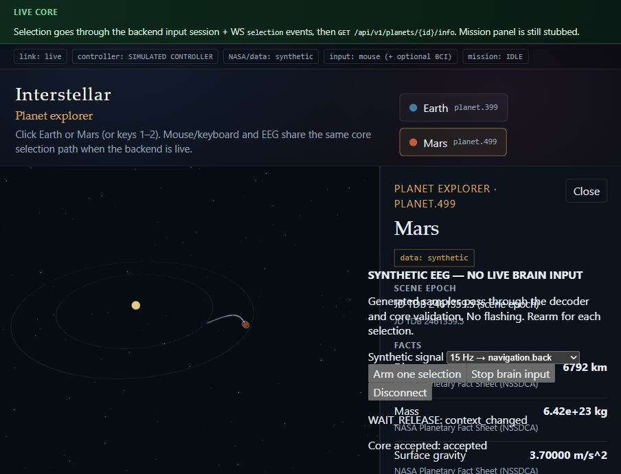

# Observed synthetic browser smoke — November 14, 2026 (Toronto)

Environment: Windows, Python 3.12.10, Node 24.13.1, in-app browser at
`http://127.0.0.1:5173`. Brain code `67312dd`, merged core `ca3c452`,
frontend review branch `481c6ba`. Used an ignored combined frontend test copy;
no edits to another owner's source. Core dependencies served synthetic fixtures.

- Backend: simulator, `BRAIN_ENABLED=true`,
  `FRONTEND_DEV_ORIGIN=http://127.0.0.1:5173`.
- Frontend: `VITE_BRAIN_ENABLED=true`, Vite proxy to port 8000.
- Bridge: `python -m app.brain.service --origin http://127.0.0.1:5173`.
- Temporary local launch token entered in widget; no token saved in this artifact.

Observed through browser controls and rendered state:

1. UI displayed LIVE CORE, SIMULATED CONTROLLER, synthetic data, mission IDLE.
2. Connect brain -> WAIT_RELEASE with persistent SYNTHETIC EEG / NO LIVE BRAIN INPUT.
3. Arm generated 10 Hz -> actual core acceptance; Earth picker selected and Earth
   information card populated from the API.
4. Select generated 15 Hz on info screen and explicitly rearm -> accepted back;
   card closes and neither planet is selected.
5. Explicitly rearm generated 15 Hz on choice screen -> accepted Mars; Mars picker
   selected and matching Mars card opens. Mars weather is unavailable.
6. Disconnect brain -> widget shows disconnected; mission remains IDLE.
7. Close card, then ordinary Earth click -> matching Earth card still opens.

This proves the generated-signal -> decoder -> core intent -> selection event ->
matching visible planet card path. Each step was operator-armed. It is not live
EEG, replay, a hardware mission, a monitor timing calibration or a human accuracy test.
The independently automated API suite covers ten repeatable selections; this
browser observation covers one Earth/back/Mars sequence and ordinary-input recovery.

Frontend issues reported to Cursor:

- At the captured 904x690 viewport, the BCI slot overlaps information-card text.
  Give it a dedicated, non-overlapping layout.
- Clicking Earth/Mars while already on planet_info is still enabled but rejected
  with action_unavailable. Close first works; picker availability/navigation should
  match core context. No attempt to bypass the core action guard was made.

